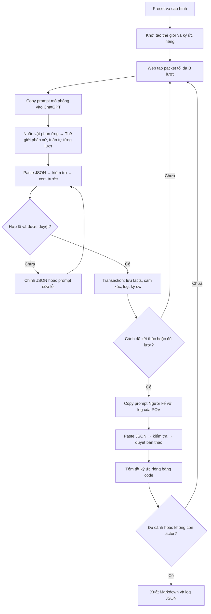
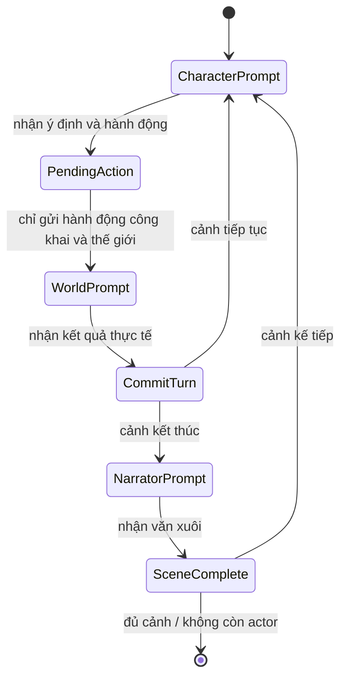

# Kiến trúc Story Stage

Phần bổ sung phase 2, hợp đồng manh mối/reader và migration: [PHASE2.md](PHASE2.md). Các mô hình lõi bên dưới tiếp tục được dùng cho truyện không có hồ sơ.

Phase 3 bổ sung chất liệu, mạch riêng, phiên bản văn xuôi, chương và nhánh: [PHASE3.md](PHASE3.md).

## Vai trò và ranh giới

| Module | Trách nhiệm | Quyền thay đổi trạng thái |
| --- | --- | --- |
| Director (người dùng) | Tình huống mở, luật, dàn vai, giọng kể, duyệt kết quả | Dàn dựng trước prompt đầu tiên; sau đó duyệt packet |
| CharacterAgent | Cảm xúc, niềm tin, nội tâm hư cấu ngắn, ý định, hành động | Bản thân; không quyết định kết quả |
| WorldAgent | Khởi tạo cảnh, chọn actor, phân xử hành động, sự kiện, điểm dừng và POV | Facts mới, tiết lộ, trạng thái thế giới/nhân vật |
| Narrator | Viết các sự kiện đã xác nhận bằng văn xuôi giới hạn POV | `prose`, `summary`; không thêm facts |
| MemoryManager | Lưu quan sát/nội tâm riêng, truy xuất, tóm tắt riêng | Memory stream theo người chứng kiến |
| Manual LLM bridge | Đóng gói prompt, nhận và xác thực JSON | Chỉ commit packet hợp lệ đúng job/revision |
| Scheduler | Ưu tiên actor World chọn; dự phòng theo vòng, bỏ người vắng/chết | Gợi ý actor cho prompt; không tạo hành động |

Ứng dụng không chạy các worker LLM độc lập tự động. “Agent” trong mô phỏng là một vai trò có trạng thái và phạm vi dữ liệu riêng. Mode `batch` mô phỏng nhiều vai trong một câu trả lời; mode `isolated` tách prompt và lưu ý định trước khi WorldAgent phân xử. Có thể copy/paste thủ công hoặc dùng [skill viết hết truyện](AGENT-WRITER.md) để một Agent có shell/filesystem tự lấy job, viết output và lưu qua backend. Skill không tạo cách ly kỹ thuật giữa các vai trong cùng phiên Agent.

## Luồng gộp lượt



Gộp setup cảnh vào packet đầu; gộp phản ứng/cảm xúc/hành động/kết quả/sự kiện/điểm dừng/POV vào mỗi packet. Những bước lọc ký ức, chọn actor, lưu trạng thái và tóm tắt không cần hỏi ChatGPT.

Với T lượt tối đa, B lượt/packet: **ceil(T / B) + 1** lần trao đổi mỗi cảnh. Mặc định truyện mới T=6, B=6 → 2 lần/cảnh; B=3 → 3 lần/cảnh. Không bao gồm sửa lỗi JSON hoặc viết lại tùy chọn.

## Luồng tách nhân vật



Tách reflection + mood + planning của một nhân vật thành một câu trả lời. Gộp action application + world update + event + end check thành một câu trả lời Thế giới. Công thức **2T + 1** lần/cảnh; T=6 → 13.

Để cách ly ngữ cảnh, mỗi CharacterAgent dùng cuộc trò chuyện riêng. WorldAgent dùng cuộc riêng. Narrator dùng cuộc mới khi đổi POV. Chỉ lọc prompt hiện tại không xóa thông tin đã có trong lịch sử hội thoại của ChatGPT.

## Mô hình dữ liệu trong aggregate

`project` là đơn vị transaction:

```text
project
  id, name, genre, premise, config, revision, status
  world: setting, rules[], location, time, pressure, facts[]
  characters[]: profile, goals[], secret, limitations[], status,
                mood, beliefs[], trust{}, memories[]
  scenes[]: title, number, atmosphere, location, time,
            turns[], pov_id, end_reason, prose, summary, status,
            versions[], current_version_id, narrator_context, checkpoint
  exchanges[]: id, kind, base revision, prompt, raw response,
               parsed response, status, timestamps
  pending_job_id, pending_action, memory_sequence
  threads[], chapters[], manuscript_revision, manuscript_events[]
  pending_rewrite_job_id, branch_origin?
```

Character status gồm `active`, `absent`, `dead`. Chỉ chọn `active`; `dead` không được chuyển lại thành người sống. `status_updates` của WorldAgent cần nhân vật có mặt trong witnesses và lý do cụ thể. Trong packet gộp, Thế giới chọn actor sau mỗi kết quả, có thể thay đổi thứ tự vì sự kiện. Không còn actor → viết cảnh cuối rồi kết thúc mô phỏng.

WorldAgent chọn actor ngay trong packet gộp và trả `scene.next_actor_id` cho packet/cảnh kế tiếp. Mode tách vẫn giữ đúng người đã có pending_action ở bước phân xử. Nếu next_actor_id=null, web dùng vòng dự phòng tiếp nối qua cảnh, không luôn khởi động lại từ nhân vật thứ nhất. Không cần một lượt hỏi LLM riêng để chọn actor.

### Sự thật, niềm tin, bí mật

```json
{
  "id": "f-report",
  "text": "Một biên bản cũ đã bị bỏ khỏi hồ sơ.",
  "known_by": ["quan"]
}
```

`known_by: []` là sự thật chỉ World biết. Sự thật ban đầu công khai được gán tất cả ID. Fact có nội dung bất biến; actor không tự có quyền thấy nó. `reveals` mở rộng người biết khi có kết quả quan sát tương ứng. Những sự thật phát sinh có ID mới; không cho nhập trùng ID.

Niềm tin dùng cấu trúc `{text, confidence, evidence_fact_ids}`. `evidence_fact_ids` phải là fact actor đã biết **trước lượt đó**. Niềm tin chỉ cập nhật `beliefs`, không ghi trực tiếp vào World facts. Trong packet gộp, actor sau có thể dùng fact đã học từ kết quả lượt trước.

Bí mật hồ sơ tự được đưa vào fact `secret_<character_id>`, ban đầu chỉ chính nhân vật biết. Khi xuất preset từ trạng thái hiện tại, giữ cả người đã được biết bí mật; không làm mất manh mối đã hé lộ.

### Emotion và quan hệ

`fear`, `anger`, `hope`, `guilt` ở 0–100. Nhân vật tạo giá trị mới khi phản ứng; code kiểm tra thang, World không tự thay lựa chọn. Ở mode tách, mood/niềm tin chỉ trở thành trạng thái chính thức khi kết quả World được nhập.

`trust` là map ID → −100…100. `trust_updates` gồm target, delta giới hạn −30…30 và reason, cập nhật quan hệ của actor. Quan hệ đối xứng không được giả định: A tin B không đồng nghĩa B tin A.

### Ký ức

- `background`: nền của riêng nhân vật.
- `reflection`: nội tâm hư cấu ngắn, chỉ gán cho actor.
- `observation`: action + outcome hoặc sự kiện, chỉ gán witnesses.
- `summary`: tóm tắt quan sát riêng trong cảnh và reflection cuối của chính người đó.

Mọi bản ghi giữ `scene_number`, `source_id`, `importance` và thứ tự. Không bỏ ký ức cũ khỏi database. Khi tạo prompt, xếp hạng theo độ trùng từ khóa, importance, recency và ưu tiên summary; chỉ gửi `memory_limit` bản ghi. Đây là heuristic bằng code, không dùng embedding/LLM. Summary rút gọn cơ học tới 3.200 ký tự; bản gốc vẫn có trong log.

`Narrator.summary` chỉ phục vụ bản thảo, **không thành ký ức chung**. Nếu dùng summary toàn cảnh cho mọi nhân vật, bí mật sẽ bị rò sang cảnh kế.

## Manual LLM bridge và hợp đồng

Mọi câu trả lời chứa:

```json
{
  "exchange_id": "x_...",
  "revision": 0,
  "scene_number": 1,
  "kind": "simulation"
}
```

Ngoài envelope, `simulation` chứa `scene` và `turns`. `character` chứa `character_id`, thought, intention, mood, action, belief_updates. `resolution` chứa scene, outcome, witnesses, new_facts, reveals, status_updates, trust_updates và world_event. Mô phỏng/phân xử có `thread_updates` tùy chọn. `narration` chứa pov_id, prose, summary, used_turn_ids; `rewrite` thêm base_version_id. Cả hai bước văn xuôi có thể gửi continuity_review. Prompt luôn in một ví dụ JSON đầy đủ với ID đúng, không yêu cầu người dùng tự điền ID.

Schema chính thức ở [src/schema.js](../src/schema.js). Bộ nhập nhận một JSON hoàn chỉnh, kể cả lời dẫn/code fence, lớp bọc output và một số lỗi cú pháp phổ biến. Có nhiều output hoặc bị cắt dở thì chặn, không ghép hay dựng phần còn thiếu. Metadata thiếu lấy từ job; metadata đã ghi sai vẫn bị chặn. Sai cấu trúc trả path lỗi cụ thể. Xem [IMPORT-AND-CREATION.md](IMPORT-AND-CREATION.md).

Kiểm tra trước khi commit:

1. Job đang pending, chưa bị hủy/nhập; job thuộc project và revision hiện tại.
2. Envelope khớp nguyên ID, scene_number và kind.
3. Actor tồn tại và đang active; ở mode tách phải đúng người có pending_action. Không thừa lượt. Thiếu lượt chỉ khi ended=true.
4. Actor có trong witnesses; ID nhân vật có thật; mood/trust/confidence đúng thang.
5. Fact mới không trùng ID; người biết/nhận reveals nằm trong witnesses.
6. Niềm tin không có evidence từ fact actor chưa biết.
7. POV chứng kiến ít nhất một lượt; bản thảo giữ đúng POV và used_turn_ids.
8. Không hồi sinh nhân vật chết; lưu trạng thái và log đồng thời.

Preview chạy trên bản sao, không ghi database. Commit chạy toàn bộ trên một bản sao working, chỉ thay aggregate khi mọi bước qua kiểm tra. Vì vậy lỗi ở lượt thứ ba không lưu lỡ hai lượt đầu.

Kiểm tra bằng code không hiểu toàn bộ ngữ nghĩa: model có thể viết một new_fact mâu thuẫn về ý nghĩa dù ID khác, hoặc viết văn xuôi thêm điều không có trong log. Prompt cấm điều đó; bước xem trước để người viết duyệt vẫn cần thiết.

## MySQL

Schema nền ở [db/001_initial.sql](../db/001_initial.sql), các bổ sung ở `002_case_setup.sql`, `003_manuscript.sql`, dùng InnoDB + utf8mb4:

| Bảng | Nội dung | Bảo đảm |
| --- | --- | --- |
| `projects` | Canonical aggregate JSON, tên, revision, timestamps | Một hàng khóa được toàn bộ cảnh đang cập nhật |
| `prompt_jobs` | Prompt, raw/parsed response, trạng thái, base revision | ID duy nhất, FK về project, lịch sử riêng |
| `simulation_events` | Câu trả lời đã nhận theo revision | Unique `(project_id, revision)`, audit đã commit |
| `manuscript_events` | Nhập/sửa/khôi phục/viết lại, chương và cách kể | Unique `(project_id, revision)` theo manuscript_revision |

Chọn aggregate JSON cho phiên bản đầu vì một thao tác luôn thay nhiều phần của cảnh, world và memories. Các phần khác nhau vẫn có mô hình riêng trong JSON; dữ liệu có thể bổ sung projection/relational tables khi cần tìm kiếm hàng loạt nhân vật hoặc báo cáo liên truyện. Chưa tuyên bố schema hiện tại có các bảng relational characters/scenes/memories riêng.

Transaction commit:

```text
beginTransaction()
SELECT payload FROM projects WHERE id=? FOR UPDATE
  → kiểm tra job pending/revision
  → dựng working copy, validate, apply
UPDATE projects ...
UPSERT tất cả prompt_jobs có trạng thái hoặc response đổi ...
INSERT simulation_events cho packet mô phỏng mới ...
INSERT manuscript_events cho phiên bản/thao tác biên tập mới ...
commit()
```

Mọi statement trong transaction dùng cùng một connection từ pool. Hai request đồng thời cùng job: request thứ hai chờ khóa, sau đó đọc job đã consumed và nhận 409. Query dùng parameter binding. Lỗi bất kỳ rollback, không cập nhật dở dang.

Một prompt mô phỏng và một prompt viết lại có thể pending cùng lúc. Mô phỏng dùng `revision`; biên tập dùng `manuscript_revision` và ID bản nguồn. Store đồng bộ từng job đã đổi, kể cả job nằm giữa lịch sử, và audit viết lại không tăng revision mô phỏng. Danh sách dự án đọc payload rồi sắp xếp theo updated_at trong Node để MySQL không phải filesort JSON lớn.

Tham khảo chính thức: [Fastify validation](https://fastify.dev/docs/latest/Reference/Validation-and-Serialization/), [mysql2 Promise wrappers](https://sidorares.github.io/node-mysql2/docs/documentation/promise-wrapper).

## HTTP endpoints

| Method | Endpoint | Tác dụng |
| --- | --- | --- |
| GET | `/api/health` | Trạng thái và storage mode |
| GET | `/api/presets` | Dàn dựng mẫu đầy đủ |
| GET / POST | `/api/projects` | Danh sách / tạo truyện |
| GET | `/api/projects/:id` | Aggregate hiện tại |
| PATCH | `/api/projects/:id/setup` | Chỉnh trước prompt đầu tiên |
| POST | `/api/projects/:id/jobs` | Tạo/trả prompt đang chờ |
| POST | `/api/projects/:id/jobs/:job/preview` | Kiểm tra và xem trước `{raw}` |
| POST | `/api/projects/:id/jobs/:job/commit` | Nhập `{raw}` đúng một lần |
| POST | `/api/projects/:id/jobs/:job/cancel` | Hủy prompt pending |
| GET | `/api/projects/:id/export?format=...` | markdown / json / preset |
| PATCH | `/api/projects/:id/writing` | Độ dài, giọng kể, batch cho prompt mới |
| PUT | `/api/projects/:id/chapters` | Tên chương và nhóm cảnh theo thời gian |
| POST | `/api/projects/:id/scenes/:scene/versions` | Tạo bản sửa trực tiếp |
| POST | `/api/projects/:id/scenes/:scene/restore` | Tạo phiên bản từ bản đã chọn |
| POST | `/api/projects/:id/scenes/:scene/rewrite` | Prompt viết lại độc lập |
| POST | `/api/projects/:id/scenes/:scene/fork` | Dự án nhánh từ checkpoint trước cảnh |
| GET | `/api/research` | Nhận xét hai truyện và nguồn |

## File và trách nhiệm

```text
src/server.js     Fastify, HTTP schema, static UI
src/store.js      MySQL transaction, file store cho demo
src/engine.js     State machine, validation ngữ cảnh, preview/commit
src/prompts.js    Scheduler và prompt, gồm case_setup đầu truyện
src/memory.js     Ký ức riêng, retrieval, scene summary
src/schema.js     Zod contract và parser
src/presets.js    Các tình huống mở
src/case-presets.js   Preset có hồ sơ quá khứ và chứng cứ
src/mystery.js    Kiểm tra đồ thị, nguồn phát hiện/tiết lộ, POV và reader
src/story.js      Mạch theo người biết, checkpoint và gợi ý chất liệu
src/manuscript.js Phiên bản, nguồn Reader, viết lại, chương và nhánh
public/manuscript-ui.js  Form biên tập, so sánh đoạn, copy/paste viết lại
public/          Giao diện vanilla JS/CSS tiếng Việt
test/            Engine, API, persistence và concurrency
```

Không có API client LLM, billing, tự gửi chat hoặc browser automation trong sản phẩm. Có thể bổ sung transport tự động sau mà giữ nguyên hợp đồng JSON và state machine; điều đó nằm ngoài phiên bản được yêu cầu.
